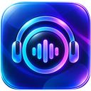

# DJConnect

**Your music. Your DJ.**

DJConnect brings a personal music DJ to Home Assistant. Set up version **4.0.0**
to ask for music, control playback, and hear DJ contributions through Assist,
a DJConnect app, or a supported device.

[Open DJConnect in Home Assistant Marketplace](https://my.home-assistant.io/redirect/marketplace_repository/?owner=pcvantol&repository=djconnect&category=integration)

[English](docs/user/installation.md) · [Nederlands](docs/user/nl.md) ·
[Deutsch](docs/user/de.md) · [Français](docs/user/fr.md) · [Español](docs/user/es.md)

## Before you start

- Use **Home Assistant 2026.11.1 or later**. Set up an Assist pipeline with an
  available conversation agent. For the full voice experience, configure
  speech-to-text (STT) and text-to-speech (TTS). STT/TTS are optional for setup.
- Choose a music connection. Spotify Direct needs Spotify Premium, your own
  Spotify Developer app Client ID, and an external HTTPS Home Assistant URL.
  Music Assistant needs a configured installation and a usable player.
  Choose **Later / manual** to continue without Spotify login.
- Assist works without a paired DJConnect device. For local pairing, keep your
  device and Home Assistant on the same LAN. ESP32 needs 2.4 GHz Wi-Fi.

## Install

1. [Open DJConnect in Marketplace](https://my.home-assistant.io/redirect/marketplace_repository/?owner=pcvantol&repository=djconnect&category=integration). To add it manually on Home Assistant 2026.11, go to
   **Settings → Marketplace → Add from link**, enter `pcvantol/djconnect`,
   and select **Integration** if asked.
2. Install **DJConnect**.
3. Restart Home Assistant if prompted.
4. Open **Settings → Devices & services → Add integration → DJConnect**.

## Start your first session

1. Select **Assist**, a **local device**, or an **app**.
2. Pair when asked. Assist skips pairing. iPhone/Watch use the QR code. On macOS,
   use the Home Assistant URL and six-digit code shown. For ESP32 and Raspberry Pi,
   follow the local pairing instructions. Restart the pairing step if a code expires.
3. Choose an existing **Profile** to keep its music connection, or create a new
   profile and select Spotify Direct, Music Assistant, or Later / manual.
4. For Spotify Direct, register the exact redirect URI shown in the wizard in
   your Spotify Developer app. Enter the app's Client ID and authorize Spotify.
   For Music Assistant, select your configured player.
5. Start a session in your connected client, or select **DJConnect DJ** in Assist.
   If you deferred the music connection, configure it in the integration options
   before requesting playback.

[Spotify setup](docs/user/spotify-direct.md) · [Setup help](docs/user/troubleshooting.md)

DJConnect repositories are MIT-licensed; this HA integration may be distributed
separately for DJConnect devices. Copyright (c) 2026 Peter van Tol.
Third-party dependencies keep their own licenses: [notices](THIRD_PARTY_NOTICES.md).
Spotify is a trademark of Spotify AB. DJConnect is not affiliated with, endorsed
by, or sponsored by Spotify AB. [License](LICENSE).
