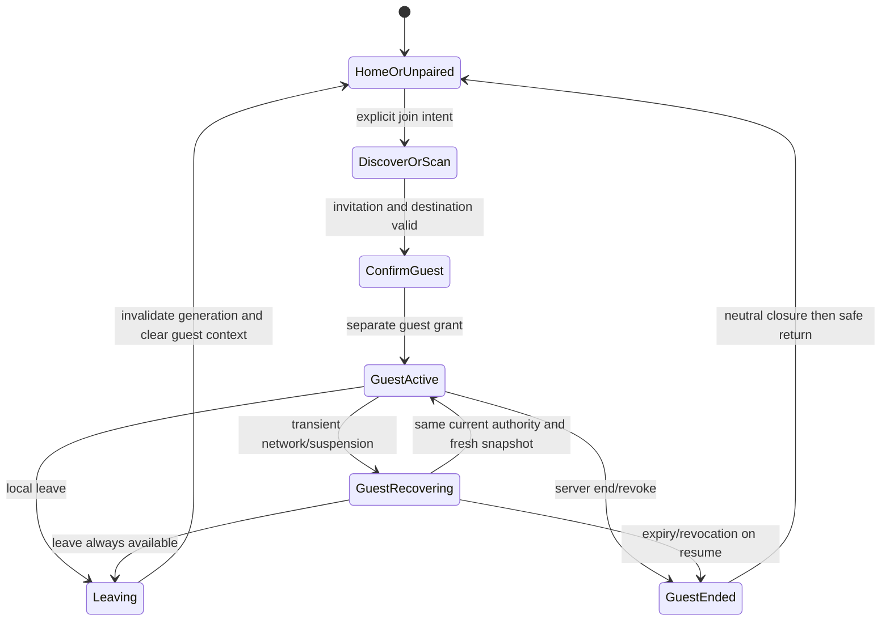

# Apple temporary VibeCast guest mode v1

Status: **design only; Apple adoption Planned; native/joint acceptance OPEN**.
Authority: [#1174](https://github.com/pcvantol/djconnect/issues/1174).
Parent: [web-first experience](VIBECAST_WEB_FIRST_EXPERIENCE_V1.md).
Security: [guest authority](VIBECAST_ONBOARDING_GUEST_AUTHORITY_V1.md).
Existing [native owner surfaces](APPLE_SESSION_NATIVE_SURFACES_V1.md),
[Profile onboarding](PROFILE_REUSE_ONBOARDING_CONTRACT.md) and Apple #87 work
remain independent. This design creates no Swift/API/discovery implementation.

## Resolved app exception and two entry locations

The exception to web-first is participation in the **existing DJConnect app**;
there is no implied native-TV product. On the **unpaired pairing screen**, both
Find VibeCast via mDNS/Bonjour and Scan guest QR are available without completing
home HA pairing. In the **normal paired main view**, after contextual local-network
permission, opportunistic discovery makes a **top menu item light up** when an
invitation is available. Use a calm accessible accent and text/status cue, not
blinking or automatic navigation/join. Selecting it opens explicit participation
confirmation; multiple sessions require a chooser. QR remains an independent
entry in both locations when discovery is denied or unavailable.

Discovery is a hint, never admission or physical-location proof. Permission is
requested in context, then discovery is opportunistic; no coercive launch prompt.
Guest identity/transport/storage and home-return behavior below apply equally to
both entries. The WebView versus native-renderer decision remains OPEN.

## Two scanner intentions

| Entry | Pairing requirement | Result |
| --- | --- | --- |
| Connect a display (owner scanner) | Paired to chosen HA; confirm installation and destination | Step A redirects exact waiting browser; Step B independently admits display |
| Join existing VibeCast session (guest scanner) | None; accessible before normal app onboarding | Same invitation/guest principal as browser, no owner authority |
| Ordinary phone camera | None | Browser guest page; no assumed app opening on arbitrary HA domain |
| Pairing screen discovery or guest QR | No home pairing; contextual permission for discovery only | Explicit guest confirmation; QR works independently |
| Paired main-view highlighted top item or guest QR | Existing home pairing unchanged; contextually permitted opportunistic discovery | Choose session, then consciously join; no automatic switch |

Invitation endpoints may use arbitrary owner HA domains. Do not assume universal
links/app association across them. The app scanner is an explicit in-app intent;
camera-to-browser remains the general path. Validate invitation type and origin,
show destination/session context and confirm joining; never reinterpret an owner
QR as guest admission or overwrite home pairing to make a scan succeed.

## Discovery and deliberate join

HA may advertise a narrow local service while participation is open; exact
Bonjour service type/schema is a future registered contract decision. Announce
only minimal non-secret discovery hints, no access token, owner name/Profile,
HA credentials or guest transcript. Advertisement is discovery, not authority.
Revalidate share/admission status with HA after selection. A TV webpage cannot
provide native mDNS advertisement. Stop/expire advertising on share/admission
close; guests already admitted retain only their own current grants.

Apple owns local-network permission copy/Info.plist and Bonjour SDK use, reviewed
against [TN3179](https://developer.apple.com/documentation/technotes/tn3179-understanding-local-network-privacy).
No permission prompt before meaningful discovery intent. Denial offers scan;
no repeated nagging or home pairing reset. VLAN, guest Wi-Fi isolation and
multicast filtering can prevent discovery; remote HA cannot be assumed locally
visible. Multiple advertisements require an explicit chooser with safe labels,
then server validation. QR works when discovery does not; neither bypasses TLS,
external reachability or admission policy.

## Isolation and navigation

Guest mode contains only shared Now Playing/Flow/Forecast, reactions, bounded
information Ask DJ and Verzoeknummer. Permanent banner **VibeCast · Gastmodus**
and **Verlaat VibeCast** remain visible and accessible. No home profile/settings,
output/volume/skip, playback queue controls, home history or host end button.
Server capabilities equal browser guest capabilities; absent controls are not
an authorization mechanism.

Snapshot home navigation context before joining, preserving home HA URL,
pairing/keychain tokens, Profile, drafts and any existing home Session. Home and
guest use separate principal/installation IDs, transport objects, task generations,
cache partitions and credential stores. Never send home auth headers/cookies,
push registrations, Profile identifiers or drafts to visited HA. Guest transcript
never syncs home. Suspend home interactions while guest mode is visible; background
home lifecycle observation must not inherit guest events or start effects.

Two technical alternatives require an explicit Apple decision:

- Shared guest webview with native scanner/discovery/shell: favors one web UI;
  requires a nonpersistent isolated web data store, bounded native bridge,
  navigation allowlist, download/external-link handling and audible cleanup proof.
- Shared native renderer: can fit existing accessibility/navigation conventions;
  must consume the same shared projection/authority and avoid a second engine or
  drifting guest UI/rights. Requires separate source/adoption qualification.

Neither option is selected here. An arbitrary default WebView cookie jar or
reused owner API client is unacceptable. Browser and native app keep complete
equivalent guest capabilities; native mode is optional convenience.

## State and return contract

Leave takes effect locally immediately even offline: invalidate guest generation
first, close socket/audio, cancel unsent tasks/model requests, clear transient
views/decoded media/cookies and release guest credential; send best-effort departure
only with the old guest principal. Do not stop host/TV/other guests. Already
accepted requests may remain under server policy; do not promise reversal.
Late callbacks must be discarded before any home context can be rebound.

Restore original unpaired welcome or existing home environment. Refresh home
state with home credentials only, without new Session, playback or replay of old
pending actions. Preserved drafts are drafts, not auto-submitted messages. A
transient guest connection failure stays in explicit guest recovery with Leave,
not a silent switch that sends the next tap to home controls. Server end shows
neutral closure and safe return; it must not turn into a home-session end action.

Crash/relaunch defaults to original home/unpaired shell with no automatic guest
rejoin or pending action replay. Do not persist guest secrets in normal home
restoration. Resume from suspension revalidates expiry/share/session before
showing rich data or audio. Revocation clears guest state only; 401/403 from a
visited installation must not clear home pairing. Removal of a home integration
retains its existing home stale-pairing policy, independently of guest errors.

## Acceptance and open decisions

Exercise all WF cases in the parent document plus permission denial, discovery
chooser, home-session-preserving join, isolated cookies/auth transport, offline
leave, late callbacks, interruption during request submission and crash/relaunch.
Test actual native app, not just browser fixtures. Exercise both pairing-screen
entries and both paired-main entries, calm highlighted top item, no automatic
join/navigation, permission denial with independent QR, and multiple-session choice. Accessibility covers VoiceOver,
Dynamic Type, keyboard/Mac, focus after return, Reduce Motion and persistent mode
identity. Copy and labels ship in en/nl/de/fr/es under canonical localization.

OPEN: webview versus native renderer; exact Bonjour contract; device-family/Watch
availability (not implied by iPhone/iPad/Mac support); invite URL handling; exact
copy and cancellation policy. Apple #87's existing Moment/Presence/Speech work
continues; this document does not dispatch a guest implementation or alter its
queue. No signing, installation, APNs, widgets/Activity or release permission.
