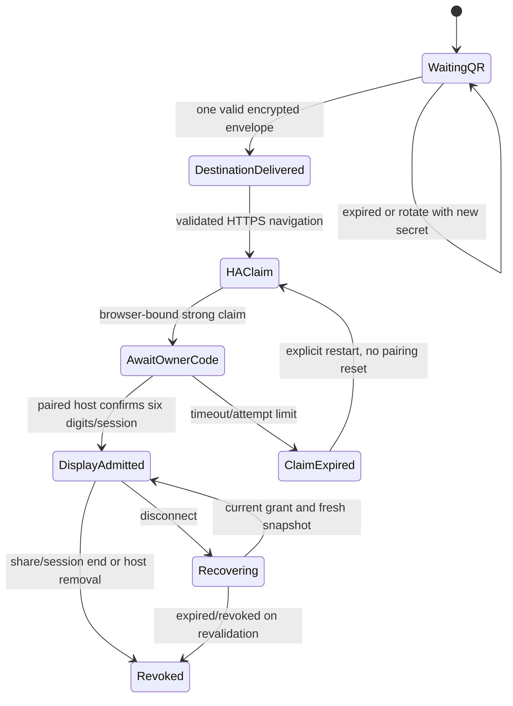

# VibeCast onboarding and temporary guest authority v1

Status: **proposed technical contract; no runtime implementation**.
Parent: [web-first experience](VIBECAST_WEB_FIRST_EXPERIENCE_V1.md), issue #1174.
Terms below describe required future operations, not new live API paths.

## Resolved public entry and current service boundary

The public entry is https://vibecast.tv/ directly at root, per owner-reported
Cloudflare domain purchase. This does not prove DNS, TLS, account bindings,
Pages deployment or onboarding operation. Keep public alias separate from stable
wire identity; no arbitrary URL query redirect. The [web entry/distribution
contract](VIBECAST_WEB_ENTRY_DISTRIBUTION_V1.md) places generic UI/build/Pages
ownership in receiverrepo, while proposed temporary rendezvous service and its
Worker/security/deployment remain API-owned, pending exact service/wire contract.
No APNs keys, push-registration data or general Session backend may be reused.
Receiver#16 can deliver a real independently tested frontend/CI route with an
honest unavailable-service production state; no fake QR/scan/pairing success.
The original expiry/crypto/trust gates below remain separate integration gates.
Glass/Soft/Solid and Minder effecten affect only presentation; QR/code stay opaque,
still and sharp. A missing security/TLS/crypto capability cannot fall back to a
weaker protocol. Final emoji choice does not affect this bootstrap contract.

## Trust boundaries and minimum central service

Pages serves generic bootstrap code, not HA data. A small Worker with temporary
state (candidate: Durable Object per rendezvous) handles wait/deliver/consume and
expiry. Pages Functions may bind an existing Durable Object, but the object
itself needs a separate Worker deployment; consult
[Functions](https://developers.cloudflare.com/pages/functions/) and
[bindings](https://developers.cloudflare.com/pages/functions/bindings/).
This is an architecture proposal requiring service-owner/cost/privacy review,
not a selected Cloudflare deployment. Receiver repo owns generic web UI;
`djconnect-api` is proposed to own the existing central API security boundary.
No central Profile, paired-device registry, session data or general chat backend.

The central operator can observe bootstrap identifiers, timing, IP/connection
metadata and code delivery. End devices necessarily see HA destination. TLS
protects transit, not operator visibility. Encryption can hide destination
payload from an honest-but-curious rendezvous operator; it cannot defend against
a compromised code host serving malicious JavaScript or a compromised owner app.
No anonymity or protection against all central compromise is claimed.

Proposed reviewed-building-block design: browser creates a CSPRNG 256-bit
wait/claim secret, fresh ephemeral encryption key pair and transaction nonce.
QR has only an opaque lookup identifier, short-lived capability, public-key
binding and protocol version; no HA URL or permanent token. Owner scanner
validates the canonical bootstrap origin/version, shows a screen comparison
code and explicit destination/installation confirmation. It uses a separately
reviewed standard authenticated encryption envelope for that browser key,
with version, transaction ID, expiry, origin and key fingerprint bound as
associated context. A matching short comparison code is shown on both devices
to reduce scanner/browser misbinding. The envelope carries only destination
and transaction context, never a session/owner bearer. Do not design raw custom
ECDH/KDF/nonce composition in application code. Exact library/protocol, sender
binding and cross-browser test vectors remain a security gate.

The destination must be the selected paired installation's configured external
HTTPS receiver origin/path, without userinfo, arbitrary redirect chain or
embedded credentials. App validates it against its own stored installation and
HA response; browser permits only the expected receiver path semantics, HTTPS
and an explicit visible destination. Central service never fetches that URL
(no SSRF). Normalize origin/port/IDNA under a reviewed URL parser; reject
ambiguous encodings, javascript/data schemes and mixed content. Destination
confirmation belongs to the owner action, not to a central open redirect.

The selected Core display-admission draft now proposes an explicit direct-
navigation trust handoff: after the bootstrap authenticates and validates the
initial selected HA entry, that HA/proxy is the trusted execution boundary.
The route must answer direct200 without login/redirect hops; this is a measured
configuration requirement, not a browser-JavaScript promise to intercept later
HA/content/service-worker navigation. This corrects the earlier absolute
enforcement implication and still requires joint design review before freeze.
No arbitrary input/query redirects, credentials in URLs or unverified origins
are permitted. See the [exact Core route decision](VIBECAST_DISPLAY_ADMISSION_V1.md#core-route-decision-explicit-trust-handoff-joint-review-still-open).

A malicious central operator may substitute keys or state; comparison and
cryptographic binding must be independently reviewed before claiming resistance
to that attack. If the chosen protocol cannot authenticate the two displays,
stop rather than claim end-to-end authenticity from encryption alone.

## Expiry and secrets

Proposed starting bounds, **unqualified until browser/load/security review**:
QR/rendezvous 120s, six-digit verification 120s with at most five failed attempts
per claim and installation-wide limits, invitation 120s; guest/display online
lease at most 60s refreshed only while share/session/authority remains valid.
Rotation changes secrets/nonces and invalidates outstanding old transactions.
All high-entropy values are CSPRNG-generated, single-purpose and constant-time
compared where applicable. Short code alone cannot claim or poll a browser.

Wait channel requires browser secret; scanner submission requires the one-time
QR capability. First valid delivery atomically consumes it; duplicate identical
submission returns safe already-used state, competing destination never replaces
it. Browser decrypts once then destroys keys/state; expiry/close deletes pending
state. Keep bounded ciphertext only until consume/expiry; no request-body,
URL-query, QR, token or destination logging, analytics/session replay or crash
uploads. Infrastructure access logs need explicit minimization/retention review;
short operational counters contain no identifiers or content. No permanent
HA/Profile/Spotify/device credentials go to bootstrap, QR, central URLs or logs.

Secrets stay memory-only by default. No localStorage/sessionStorage/service-worker
cache of grants/content. If implementation needs app secure transient storage,
its exact lifetime and protection need separate review. Never put a bearer into
query/referrer; guest invitation in a URL fragment is a candidate transport to
first-party guest code, immediately removed before redemption. The HA URL still
necessarily reaches HA/proxy; configure no-referrer/no-store and no third-party
assets. Invitation links are bearer-equivalent until redeemed, not harmless
public labels. QR screenshots can admit others until expiry/rotation.

## A then B, not one generic pairing

Use [RFC 8628](https://www.rfc-editor.org/rfc/rfc8628) as a reference for separate
user/device code entropy, expiry and throttled polling; this design is not a
claim to implement OAuth device flow. A six-digit code is only a verifier for a
strong browser claim. Paired owner approval must recheck loaded installation,
Profile/session, browser claim generation and opt-in policy after every await.
No strong claim token is returned to the owner app for forwarding.

| Failure | Required recovery |
| --- | --- |
| QR expires/rotates | Clear old wait/key, show fresh QR; old scanner cannot deliver |
| Double scan/competing scan | Atomic one-time result; no overwrite; explicit restart for wrong destination |
| Wrong browser/HA/installation | Comparison + selected-install confirmation; deny mismatch, cancel/restart exact claim |
| Owner app unpaired | Explain owner scanner needs pairing; guest join remains available separately |
| Multiple owner installations | Explicit chooser and destination/session confirmation, no last-used silent approval |
| Missing external URL | Owner configures valid existing remote-access path later; no hostname guessing |
| TLS/DNS/reachability failure | Before handoff report known failures; after navigation browser error UI may appear before HA loads. HA owns B recovery when loaded. No false connected state, cert bypass or HTTP fallback |
| Wrong code/attempt limit | Rate-limit bounded claim, no global enumeration; regenerate claim after expiry |
| Central outage | Existing connected sessions unaffected; new central bootstrap waits/retries visibly; explicit direct HA entry only when known and safe |
| HA outage/restart | Stale display expires; reconnect revalidates; expired ephemeral grants need new admission |

## Separate roles and capabilities

Every grant binds issuer installation, session, share instance, browser/app guest
identity, purpose, generation, expiry and permitted projection/effects. Separate
identifiers exist even if v1 UI offers one share. An invitation is redeem-only;
redemption creates a unique guest credential. Display grant is not invitation,
owner token or guest token. No unauthenticated write endpoint is justified by
readonly music playback.

| Capability | Paired host | Display | Guest | Invitation / central bootstrap |
| --- | --- | --- | --- | --- |
| Own Profile, history, DNA, devices | Existing owner policy | No | No | No |
| Approved shared Now Playing/Flow/Forecast | Yes | Read | Read | No |
| Artwork/speech | Existing owner grants | Explicit shared grant only | Explicit shared grant only | No |
| Playback/queue/output/skip/volume | Existing owner policy | No | No | No |
| Open/close admission; remove guest | Host policy | No | No | No |
| Reactions | Separate qualified participant action | No | Allowed subject/types/budget | No |
| Information Ask DJ | Existing owner thread | No | Separate ephemeral thread, safe tool allowlist | No |
| Request submission/clarification | Existing owner policy | No | Proposal only, exact recording | No |
| Execute accepted request | Core effect owner under host policy | No | No | No |
| Stop share / end Session | Host policy, distinct operations | No | No | No |
| Leave | Own connection | Local display close | Own guest only | Consume/expire only |

New guest operations need authenticated REST and WSS authority at dispatch,
exact browser Origin validation, CSRF protection for cookie paths, no credentialed
wildcards, bounded messages and rate limits. Prefer HA same-origin guest pages
so TV/navigation does not require central-origin CORS for Session data. A
native ephemeral guest webview has the same policy. Non-browser native calls
still require explicit grant validation; absence of Origin is not authority.
Existing owner/Broadcast tokens do not automatically become new guest grants.

REST handles bounded redeem/read/submit/remove/reconcile. WSS supplies authorized
shared snapshots/deltas, statuses and terminal/revocation events. Snapshot-first,
subject/generation/revision checks, dedupe and expiry survive reconnect; do not
replay guest effects on reconnect. Missed state recovers via current authorized
snapshot, never private owner journal/history. Each effect has original operation
identity; stale retry/confirmation cannot switch principals or sessions.

## Shared projection and media fence

Core must build an explicit shared allowlist projection, not serialize an owner
snapshot then hide fields in CSS. It may carry safe public track metadata,
approved Flow/Moments, conditional Forecast and bounded anonymous aggregate/
request notices. Exclude owner Ask DJ text, profile/instance/device lists,
internal Planner/Horizon, private context and provider/token material. Retain
source links and source-specific attribution. Rights must cover this audience,
channel, locale, live subject and expiry; visual qualification is not speech or
historical permission. Reuse producers; do not reopen completed delivery to claim
shared acceptance. Existing private `session_media` and owner history/speech
endpoints remain denied to guests/displays.

Shared bytes need their own capability: object/subject/source/account/edition,
share/session generation, display/speech purpose, original deadline and
revocation. Media reads revalidate after awaits; batch preparation revalidates
all results before release. Cache expiry is min(content, asset, grant, share).
Decoded pixels/audio buffers are removed too. Session-end notification and
server revocation close active media delivery; already sent bytes/screenshots
cannot be recalled. No automatic image/music fetch based on client inference.
Shared TTS is optional only after qualified rights and room/audio policy;
owner private speech descriptors cannot be repackaged as guest assets.

## Guest chat, request effects and abuse

Reuse the existing Ask DJ engine with a server-created guest execution context.
A closed allowlist resolves only safe shared questions/catalog clarification
and bounded request proposals. Capability checks occur before dispatch, after
model/tool awaits and immediately before effects. Tool output, model text,
retrieved content and client-supplied references are untrusted. A guest cannot
submit an owner confirmation, retry an owner operation or select a result from
another guest. Guest thread key is (share, guest, generation), not HA user or
home Profile. Apply guest+share call/token/time/concurrency budgets and session
capacity before spending model work; return explicit limit status, never a new
provider fallback. Thread context expires with guest/share/session and never
enters owner history/DNA; guest free text is not diagnostics or TV content.

Host policy may allow DJ consideration of requests. Planner receives a typed
proposal, not a guest command. Before actual enqueue the existing effect owner
checks policy, exact recording/availability, session generation and original
operation id. Cancellation before send prevents effect; after send ambiguous
outcome is recorded/reconciled without duplicate enqueue. Session/share revoke
cancels queued work and prevents new effects. In-flight effects may already have
reached backend and must be reported honestly; no rollback promise. Actual
observed matching playback, not model acceptance/enqueue response, is the
announcement trigger. Queue order/timing is not promised.

| Threat | Control and residual limit |
| --- | --- |
| QR theft/photo, guessed short code | High entropy, short TTL, one-time redemption, host close/rotate/remove; no physical-presence claim |
| Cross-origin injection/open redirect | Exact origin/path/HTTPS, browser-bound context, explicit owner confirmation; hostile code host remains trust root |
| Token theft/replay | Purpose/session/share/generation/subject binding, no logs/URLs/storage, revoke and bounded leases |
| Owner-confused-deputy / LLM injection | Principal fixed by server, strict tool/effect allowlist, no prompt-derived authority |
| Many fake guests / floods / spend | Per guest+share+issuer quotas, admission capacity, backpressure and host controls; no hidden fingerprinting or one-person guarantee |
| Late callbacks/end/media race | Generation fence and post-await authority check; server-terminal state wins |
| Private text/art/audio disclosure | Server allowlist, independent source grants, safe notices, no owner history projection |
| Suspended/offline stale content | Presentation lease, neutral stale state, resume revalidate; no instantaneous offline pixel erasure |

Session end immediately revokes all related grants/invitations, signals live
connections, invalidates media and cancels pending guest work. Share close does
the same for only that share. Guest leave revokes only that guest; renewing an
invitation affects only future redemption. HA restart must fail closed for
non-persisted authority. Guest/display leases never outlive their original
Session or revive on reconnect. TTL/retention values above remain unqualified
starting proposals, not production settings.

## Primary-source checks and implementation gates

Sources checked 2026-10-15: [HA remote access](https://www.home-assistant.io/docs/configuration/remote/)
for externally reachable HTTPS; [RFC 6762](https://www.rfc-editor.org/rfc/rfc6762)
for link-local discovery scope; [Apple TN3179](https://developer.apple.com/documentation/technotes/tn3179-understanding-local-network-privacy)
for native local-network permission (page requires JavaScript; native entitlement/
permission details must be rechecked against the implementing SDK).
[Spotify enqueue](https://developer.spotify.com/documentation/web-api/reference/add-to-queue)
requires supported account/scopes and does not guarantee ordering with other
player operations; [Spotify policy](https://developer.spotify.com/policy) needs
specific assessment before public shared artwork/metadata/request/speech use.
Access to metadata is not permission to feed it to an AI model or synthesize
unqualified speech. Reuse existing source-rights restrictions and evidence.

Security baseline: OWASP [authorization](https://cheatsheetseries.owasp.org/cheatsheets/Authorization_Cheat_Sheet.html),
[WebSocket](https://cheatsheetseries.owasp.org/cheatsheets/WebSocket_Security_Cheat_Sheet.html),
[prompt injection](https://cheatsheetseries.owasp.org/cheatsheets/LLM_Prompt_Injection_Prevention_Cheat_Sheet.html).
These are design inputs, not security certification. Crypto choice, origin-bound
bootstrap, old-browser capability, retention/access logs, source licenses and
exact denial/effect tests must be independently reviewed before implementation.

## Selected Core display-admission review

Owner6222775045 selects the existing Core writer for
[DJC-CORE-VIBECAST-DISPLAY-ADMISSION-V1-20261016](VIBECAST_DISPLAY_ADMISSION_V1.md).
That contract records the exact current trust-anchor gap, proposed external route,
separate A/B states and controlled legacy-end inventory before runtime. It is
NOT_FROZEN; it creates no live endpoint, consumer adoption or deployment.
