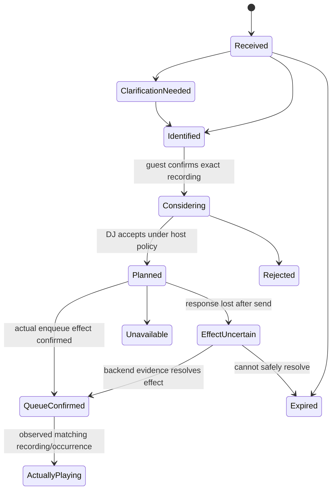

# VibeCast web-first experience v1

Status: **design only; receiver slice1 selected/queued; other implementation Planned; joint acceptance OPEN**.
Authority: [issue #1174](https://github.com/pcvantol/djconnect/issues/1174),
`DJC-VIBECAST-WEB-FIRST-GUEST-EXPERIENCE-DESIGN-V1-20261015`.
This is the canonical forward product direction. It supersedes Cast-first and
native-TV prerequisites, without changing installed behavior or historical proof.
The frozen platform ownership remains: HA owns Session, Planner, Knowledge,
Moment, playback effects and Broadcast; clients present authorized projections.

Companion contracts: [onboarding and guest authority](VIBECAST_ONBOARDING_GUEST_AUTHORITY_V1.md),
[temporary Apple guest mode](APPLE_VIBECAST_GUEST_MODE_V1.md).
These documents specify future behavior, not available routes or SDKs.

Decision delta: [DJC-VIBECAST-WEB-FIRST-DECISIONS-DELTA-V1-20261015](https://github.com/pcvantol/djconnect/issues/1174#issuecomment-6201605985).
[Web entry/distribution and Cast lifecycle](VIBECAST_WEB_ENTRY_DISTRIBUTION_V1.md)
is the technical companion for the newly resolved choices and selected receiver#16.
Source1175/Finalization1176 remain historically scoped; these later decisions
are not retrospectively claimed as part of their delivery.

## Product and explicit unknowns

One maintained web product serves TV browsers, iPad, Android tablets, PC and Mac:
ambient large-screen composition plus responsive mobile guest participation.
A Windows browser does not reopen the retired Windows app. Apple/Pi/ESP/Assist
remain supported. Cast may be an optional adapter; LG/webOS, Samsung and Android
TV native apps are not the entry condition. The web-first exception is now
**RESOLVED: joining through the existing DJConnect app**, using temporary guest
mode. It is not a native-TV exception and does not make Cast mandatory. Browser
guest participation remains complete.

The selected global entry is **https://vibecast.tv/**: its root opens the QR/start
page directly, without a required /go, /start, /connect or marketing step.
Peter reports buying the domain through Cloudflare; this is ownership context,
not DNS/TLS/Pages/live-onboarding proof. Public alias and configured service origin
remain independent of protocol identity. Earlier name candidates are historical
only. No domain purchase, DNS, hosting or deployment is performed by this delta.

## Two deliberately separate onboarding steps

**A. Find the right installation.** The screen opens https://vibecast.tv/ and
waits with a rotating short-lived QR. An already HA-paired iPhone/iPad owner
scans using the new owner scanner, selects the intended installation and confirms
the screen and external HTTPS destination. A minimal temporary rendezvous
transfers that destination only to that waiting browser. The browser validates
and navigates to its own HA receiver. Static HTML alone cannot deliver that
cross-device message. Pages plus a small stateful Worker is a proposed solution,
with crypto/service selection and old-browser qualification still gated.

**B. Admit this screen to this session.** HA displays a six-digit verification
code. The host enters it in a paired Mac/iPad/iPhone app, confirms the intended
screen/session and HA issues a narrow, temporary display grant bound to that
browser's strong claim secret. Six digits never become a durable bearer.
A later single-scan UX remains an unselected alternative.

```mermaid
sequenceDiagram
    participant D as Waiting screen
    participant C as Central bootstrap
    participant O as Paired owner app
    participant H as Own HA
    D->>C: Create expiring rendezvous, browser key and nonce
    C-->>D: Dynamic QR and wait channel
    O->>C: Scan, inspect and confirm exact screen destination
    C-->>D: One encrypted destination envelope
    D->>H: HTTPS receiver navigation; fresh browser claim
    H-->>D: Six-digit verification code
    O->>H: Authenticate owner, enter code and approve screen/session
    H-->>D: Browser-bound readonly display grant
    D->>H: Direct shared snapshot and WSS updates
    Note over C,O: Neither is a session relay or lifetime owner
```

After admission every TV and guest browser connects directly to its own
HA/DJConnect over HTTPS/WSS, potentially through an existing tunnel/reverse
proxy. No pixels, Session data or music relay through Apple or central bootstrap.
Closing the owner app or losing central bootstrap does not end an admitted
Session. Music stays on the selected backend output; participation supplies no
music stream. Externally reachable HA with valid TLS is a real prerequisite,
not a property a QR can supply.

## Adaptive glass presentation

One capability-first design has **Glass / Soft / Solid** levels, with the same
content, authority and functions. Glass adds restrained blur/translucency/gloss
only where both feature support and actual device performance qualify it; Soft
reduces blur/layers, Solid uses opaque panels. This is Apple-glass-inspired web
styling, not native Liquid Glass. Engine/brand/UA/version alone cannot qualify
performance. Prefer conservative defaults and graceful downshift; never promote
or drop security based on an effect tier.

Respect Reduce Motion, contrast and reduced-transparency preferences where
supported, with an accessible local **Minder effecten** choice. All QR and code
panels stay opaque, still, sharp, high-contrast and readable at every tier. No
animation or glare may compromise scanning. Feature checks, browser qualifications
and long-running acceptance belong to the [distribution contract](VIBECAST_WEB_ENTRY_DISTRIBUTION_V1.md).

## Shared meaning, distinct surfaces

TV is readonly. TV and guests see the same authorized shared Flow, Now Playing,
relevant DJMoments and narrative approximately 15-minute Forecast. Forecast is
conditional direction, not a guaranteed queue or next-track list. Responsive
presentation can differ in density, not semantic authority. Missing grants mean
honest omission, never a private-owner fallback.

Reuse [Forecast](SESSION_FORECAST_V1.md),
[Moment artwork](SESSION_ARTWORK_DELIVERY_CONTRACT_V1.md),
[speech rendering](../technical/SPEECH_RENDERING_CONTRACT.md),
[Broadcast](../technical/BROADCAST_TRANSPORT.md) and the
[shared renderer](VIBECAST_SHARED_RENDERER_BUILD_CONTRACT.md).
The active Speech/Persona assignment is unmerged concurrent work, not a main
producer receipt imported by this design. Producer delivery and visible/shared
consumer qualification are separate.
Owner-only `session_media`, history and speech rights do not flow into VibeCast.
Shared imagery needs subject/source/account/edition, display basis, attribution,
expiry and revocation grants of its own. Shared speech additionally needs a
qualified text/voice/room grant; absent one, silent qualified visual presentation
is valid but cannot count as full speech acceptance. No private history,
Profile/DNA, accounts/devices, Planner/Horizon, prompts or credentials are shared.

## Join with a camera, without an account

The active TV shows a second QR, **Meedoen met VibeCast**. An ordinary phone
camera opens the external HA guest page. It redeems a valid invitation into an
independent temporary guest identity, never a TV or owner token. No HA account,
app or permanent pairing is needed. Host controls remain on Profile-based
paired devices: admission open/closed, renew invitation, remove guest and set
bounded audience/request policies. Renewing an invitation invalidates new uses
of the old invitation, without inherently removing already admitted guests.
A QR photo can be forwarded; it is no proof of physical presence.

App guests may use local discovery or scan **Join existing VibeCast session**;
this is available before pairing, and also while paired to their own home HA.
[Apple mode](APPLE_VIBECAST_GUEST_MODE_V1.md) preserves that home environment.
Browser participation remains a complete product route.

## Reactions and DJ-led audience influence

The working proposal is ❤️ Raakt me / 🔥 Hier ga ik op / 😌 Heerlijk ontspannen /
🤩 Wow / 👎 Niet mijn vibe. Owner preference replaces 🤯 with **🤩**. The later
**🚀 suggestion remains OPEN as an addition or alternative**: no sixth reaction
or replacement is silently selected. Final set, count and localized labels still
need explicit owner decision. The old four-icon vocabulary is not final either.
This choice does not block bootstrap/CI slice1. Each reaction identifies
its subject: exact music/playback occurrence, DJ story, or session atmosphere.
Liking trivia does not establish liking the track; like does not mean energy up,
dislike does not mean down, and silence is not rejection. These transient events
are neither DJMoments, Spotify Favorites nor Music DNA.

HA validates session, guest, subject, reaction vocabulary, replay/deduplication,
rate and capacity limits. Bounded anonymous sparkling responses on TV use
clustering, density/concurrency limits, short duration and Reduce Motion;
readable Moments and source attribution retain priority. There is no feed,
leaderboard, personal ranking or permanent preference. A future aggregate may
inform DJ/Planner only under explicit host policy, confidence/minimum-sample
rules, a cooldown and bounded maximum adjustment. The host can lock direction.
DJ stays in lead; one click never writes Mood. Confirmed server direction changes
also reach owner apps. Accountless participation cannot guarantee one human per
vote: session/guest budgets, admission controls and anomaly throttling are
proposed; hidden fingerprinting is excluded.

## Guest Ask DJ and request numbers

Guest information chat uses the same Core Ask DJ service and Session Persona/Mood,
with shared current music/Moment context and an independent temporary thread.
It cannot read host history/Profile/DNA or invoke playback, skip, volume, output,
queue editing, settings/profile operations or Session end. Enforce this at
server/tool/effect dispatch; prompts and hidden buttons are insufficient. Retry,
result selection, confirmations and injection cannot borrow owner authority.
Per-guest and per-session budgets bound model calls and requests through the
existing HA provider route; no new provider/cost contract. Raw guest chat stays
in its guest view and temporary server context, never TV or home history/DNA.

**Verzoeknummer** is a VibeCast-only proposal flow. Short dialogue identifies
artist, track and exact recording/version; the guest confirms identity. Reuse
existing catalog/choice contracts with guest restrictions. DJ may consider,
refuse, defer or plan under host policy; submission grants no queue/skip right.
Planning and backend effects have distinct states:



The future implementation must actually enqueue through the existing playback
owner, retain an idempotent request/effect identity, and reconcile unknown
post-send outcomes without blind retry. Enqueue success is not proof of order,
timing or playing. Only observed correct recording/occurrence allows the
Persona announcement “dit is jullie verzoeknummer”. Core may compose a bounded
anonymous request notice; raw chat/user attribution never goes to TV. Duplicate
requests can coalesce by recording while keeping guest status privately; host
policy sets fairness, capacity and expiry. Leaving does not undo an accepted
request. Cancellation removes unsent work; an in-flight/committed backend effect
needs reconciliation and cannot be promised reversed. Backend/Spotify eligibility
and current terms must pass before implementation; no policy permission is
inferred from having an enqueue endpoint.

## Stop, end and stale screens

“Stop VibeCast” closes a share instance and revokes its displays, guests,
invitations and pending guest work; the host's personal Session may continue.
“End DJ session” ends the Runtime and revokes all its shares immediately on the
server. TV failure, guest leave and owner-app close do not end the Session.
Whether multiple concurrent shares are offered and exact host close controls
remain product decisions; keep identifiers separate now to avoid conflating them.

Online clients clear projections, decoded media and pending guest work on
terminal notification. Offline/suspended clients cannot be guaranteed to erase
pixels immediately. Use a bounded presentation lease, local stale handling and
revalidation before re-display/resume; no screenshot or offline erasure promise.
Server expiry/revocation never waits for a client acknowledgement. Legacy opt-in
receiver end-only grants remain installed behavior until a separately approved
migration; new web-first TV targets have no end grant or end control.

## Legacy disposition and ownership

| Existing concern | Disposition | Future boundary / preserved evidence |
| --- | --- | --- |
| Universal Receiver infrastructure | REUSE | Connection, projection, lifecycle primitives; interactive product stays separate |
| Core shared renderer/build | KEEP + ADAPT | One maintained source, local/static builds; responsive shared surface needs new qualification |
| Static receiver distribution | REUSE + ADAPT | Receiver repo owns browser artifacts/Pages; no hand-edited copies or deployment here |
| Cast/CAF adapter | KEEP optional | Historical CAF modeled/physical receipts retain exact scope; Cast-first positioning SUPERSEDED |
| Native LG/webOS plans | SUPERSEDE prerequisite; DEFER adapter | No native-TV dependency; previous undelivered plans stay undelivered, no deletion |
| Browser qualification | ADAPT | Real old-TV engine/TLS/crypto/storage/media/suspend plus phone/tablet/accessibility matrix |
| Owner-only artwork/Forecast/speech | KEEP producer | Add explicit shared grants and visible consumer proof; never reuse private bearer |
| Legacy screen end-only grant | KEEP installed; RETIRE from new design | Separate opt-in remains until authorized migration, new TV readonly |
| Prior Audience concept | ADAPT deferred | Reaction proposal, scoped chat/requests and aggregate policy extend future scope |

Core owns grants, shared projections, Ask DJ, Planner and effects. Apple owns
owner scanner and temporary app guest shell. Existing receiver repo owns static
web distribution and public bootstrap UI. Existing `djconnect-api` is the
proposed central rendezvous service owner because central short-lived API
security is already its responsibility; it is not a new Session backend.
Cross-repo service/binding placement requires owner review before implementation;
no new repository is needed. Website may link the entrypoint but does not own
a second renderer or credentials. Local discovery is an HA announcement, not
native service advertising by a TV webpage.

## Traceability, slices and acceptance

All issue sections map to durable design and DAG slices. Receiver
[issue16](https://github.com/pcvantol/djconnect-vibecast-receiver/issues/16),
`DJC-VIBECAST-TV-BOOTSTRAP-CLOUDFLARE-V1-20261015`, is **SELECTED/QUEUED** for independent public bootstrap/build/CI/CD in
WEB::DISTRIBUTION and conditionally for the receiver-owned rendezvous adapter
once the exact TRUST/API contract is qualified. This does not select producers.
There is no executor ACK or product PASS here. After this delta's protected
delivery/Finalization and closure of its own earlier WIP, the owning receiver
writer may autonomously admit that slice, without another general start question.
API rendezvous, Core admission, Apple and guest functionality remain separately
Planned/NOT_ISSUED. Full onboarding E2E stays OPEN pending their exact contracts.
The [decision mapping](VIBECAST_WEB_ENTRY_DISTRIBUTION_V1.md#decision-to-dag-mapping)
records phase-specific dependencies without dispatching those other owners.

| Issue #1174 | Canonical detail | DAG subset / owning lane |
| --- | --- | --- |
| 1 admission/coexistence | completion record + serialized integration receipt | DOCS / Core documentary writer |
| 2 web-first/legacy/exception | this document, disposition | DISPOSITION / Core |
| 3 URL/two-step bootstrap | onboarding contract, trust and recovery | TRUST → BOOTSTRAP + DISPLAY / API, receiver, Core, Apple |
| 4 direct HA/shared presentation | shared grant contract | SHARED + MEDIA / Core, receiver |
| 5 accountless guests/end | authority matrix, revocation | GUEST + BROWSER / Core, receiver |
| 6 five reactions/influence | reactions above, server budgets | REACTIONS → INFLUENCE / Core, receiver |
| 7 scoped Ask DJ | dispatch isolation, temporary thread | CHAT / Core, receiver |
| 8 real request effect | recording state machine and effect policy | REQUEST → ENQUEUE / Core, receiver |
| 9 temporary Apple mode | Apple contract, leave/home state machine | APP + DISCOVERY / Apple, Core |
| 10 docs/DAG/verification | this matrix and acceptance below | JOINT / Core coordination, no extra runtime writer |

Future acceptance must exercise the complete primary product, with exact
candidate/producer/consumer identities. Fallback-only proof is insufficient.

| ID | Required scenario / expected evidence |
| --- | --- |
| WF-01 | Central URL → QR → correct HA → six-digit code → independent TV; no owner token leak |
| WF-02 | Kill bootstrap and owner app after join; TV/guest retain direct HA, music stays on output |
| WF-03 | Ordinary camera/browser, unpaired app and home-paired app; multiple independent guests |
| WF-04 | Leave offline/online, crash/relaunch, late callback; exact home restoration, no home playback/action |
| WF-05 | Stop share versus end Session; revoke all grants/WS/media/pending work; offline stale lease and resume |
| WF-06 | All finally chosen reactions, distinct subjects, bounded sparkle/Reduce Motion, host lock and cooldown |
| WF-07 | Guest chat injection/retry/confirmation/result choice; zero forbidden effects and zero private read |
| WF-08 | Exact version → accepted plan → confirmed backend enqueue → observed playback → correct anonymous Persona announcement |
| WF-09 | Wrong origin/install/browser, QR replay/photo, brute-force/rate/model budget, leak-free logs/URLs and revocation races |
| WF-10 | Real modern WebKit/Chromium and older TV engines, Glass/Soft/Solid functional parity, long-running recovery/thermal/memory stability, sharp QR, portrait/landscape, touch/remote/keyboard/screen reader; en/nl/de/fr/es |
| WF-11 | Visible shared Forecast/art/source expiry; owner-only media denied; shared speech separately audible/qualified |
| WF-12 | VLAN/multicast/permission denial, multiple Sessions, invitation closed/rotated, central failure and honest recovery |

UI strings/accessibility/QR alternatives must follow [five-language policy](../../LOCALIZATION_STANDARD.md).
Host display must be readable at distance; guest layout supports zoom/text scaling,
contrast, focus/keyboard, screen reader labels and non-color state cues. No forced
motion or automatic speech; use short localized statuses and static reduced-motion
feedback. Exact copy/catalogue and reaction labels are implementation decisions,
to ship in all five languages together. No new user-facing runtime copy ships here.

Resolved: vibecast.tv/root and the existing-app guest-join exception. Open design
gates: final emoji set/count/labels and 🚀 addition/alternative; browser
minimum; reviewed encrypted rendezvous protocol/library; TTL/budgets and abuse
thresholds; share multiplicity and close/cancel policy; shared image/speech rights;
Apple webview versus native renderer; cross-repo central-service binding. They
block their implementation slices, not recording this design. No active release
or Speech/Artwork/Hybrid/Forecast consumer order is rearranged.
