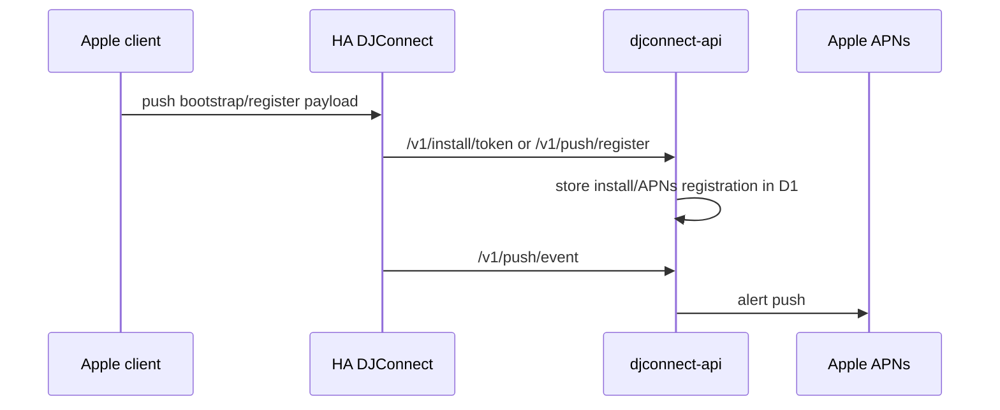

# Push notifications

## Current Core contract and diagnostics

Contract authority: [Apple Push Notifications](../../API_CONTRACT.md#apple-push-notifications)
and the owning central API contract. This summary relocates the former HACS
README explanation; it does not amend the protocol or prove native delivery.

iOS, macOS and Apple Watch clients register APNs tokens through
`POST /api/djconnect/v1/push/register`. If Home Assistant does not yet have a
per-install `djci_` relay token, the Apple client obtains a central-issued
short-lived `djcboot_` proof from the trusted Apple pairing issuer and includes
it in the `/push/register` payload. Home Assistant exchanges that transient
proof for a per-install token through `/v1/install/token`, stores only the
`djci_` token and then registers the APNs device with the relay. Home Assistant
does not locally mint, request or store bootstrap proofs. It validates the
paired client identity and forwards only redacted registration metadata to the
DJConnect relay; APNs provider keys and raw APNs tokens are never stored in Home
Assistant.

Development-signed Apple builds may send `push_environment: "development"` when
their APNs entitlement targets the sandbox. DJConnect normalizes that to
canonical `sandbox` in relay calls, status and registration responses. Production
builds must send `push_environment: "production"`. If registration reports
`missing_bootstrap_proof`, the Apple client should request a fresh proof from
the trusted Apple issuer and retry `/push/register` with `bootstrap_proof`. If
registration reports `invalid_bootstrap_proof`, `bootstrap_proof_expired`,
`bootstrap_proof_used`, `install_id_mismatch` or `bootstrap_rate_limited`,
request a fresh proof or pair the app with Home Assistant again, then retry push
registration. The legacy `/push/bootstrap` endpoint returns
`bootstrap_proof_unavailable`; HA/HACS never calls central proof-issuer routes
and never has relay, pairing-issuer or APNs provider secrets.
When Music DNA is enabled, Home Assistant sends at most one daily
`music_discovery_ready` APNs wake/sync hint around 08:00 local time with
`body:"Je nieuwe aanbevelingen staan klaar!"`, `open_target:"music_discovery"`
and a deeplink to Ontdek. Clients should open Ontdek and refresh the Music
Discovery backend feed; the push never contains recommendation contents.
Home Assistant also refreshes Music DNA and the Music Discovery cache
server-side about once per hour when Music DNA is enabled, using compact
Spotify recently-played/top profile data as recommendation seeds.

### Administrator diagnostics

The `APNs registratie` diagnostic sensor and `djconnect.test_apns_push` developer
action report readiness and errors. The action supports dry-run, or an explicitly
requested test event. Readiness is not proof of delivery. Keep the original
redaction boundaries: no APNs tokens, bootstrap proofs, bearer or install-token
values in diagnostics or reports. Pairing/transport, relay registration and
native push/voice acceptance are separate.

## Historical reconstruction (preserved)

The following July2026 reconstruction is historical evidence, including retired
client references, not current user setup guidance:

````text
# Push Notifications

## Apple Push Flow

`CONFIRMED_CODE` HA has `push.py` and HTTP routes:

- `POST /api/djconnect/v1/push/bootstrap`
- `POST /api/djconnect/v1/push/register`
- `POST /api/djconnect/v1/push/unregister`

`CONFIRMED_CODE` HA forwards registration/unregistration/events to the central
API using install tokens when available. It redacts push tokens in logs and
persists push status, not raw APNs tokens.

`CONFIRMED_CODE` Central API exposes install-token/bootstrap-proof routes and
push register/unregister/event routes. APNs registrations are stored in D1 with
token hash and encrypted token fields. Push delivery uses APNs sandbox or
production endpoint based on environment.



## Non-Apple Clients

`CONFIRMED_CODE` HA `push.py` supports Apple client types only. Windows tests
explicitly check no Apple/APNs push bootstrap flow is introduced.

## Unknowns

`UNKNOWN` Actual Apple entitlements/background mode configuration was not fully
verified in this pass.

## Verification Mapping

`APPLE-*`, `PRIVACY-*`, `NETWORK-*`, `RELEASE-*`.
````
