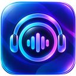

# DJConnect

**Your music. Your DJ.**

Your personal music DJ in Home Assistant: ask for music, enjoy DJ contributions
and choose your session mood through an available client or Assist.

[Open DJConnect in Home Assistant Marketplace](https://my.home-assistant.io/redirect/marketplace_repository/?owner=pcvantol&repository=djconnect&category=integration).
Install DJConnect, restart Home Assistant if prompted, then open
**Settings → Devices & services → Add integration → DJConnect**.

DJConnect **4.0.0** requires **Home Assistant 2026.11.1 or later**. Set up an
Assist pipeline with a conversation agent, plus speech-to-text and text-to-speech
for voice.
Choose Spotify Direct, Music Assistant, or Later / manual in the wizard.
Follow the setup guide for pairing and music connection instructions.

[Setup in five languages](https://github.com/pcvantol/djconnect/tree/main/docs/user)
